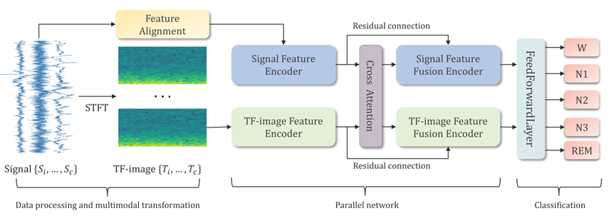

# CrossFusionSleepNet

### CrossFusionSleepNet: A Multimodal Deep Learning Model for Automatic Sleep StageClassification

by: Yang Cao, Wei Xiang, Jie Wei, ShangShang Cao, Xinhui Tian, Jiajun Zhong, Xiulian Fang, Bin Luo, He Lyu, Xiangkui Li

## Abstract

Sleep staging is used to assess sleep quality and diagnose sleep-related disorders by monitoring and analyzing physiological signals during sleep. Although previous studies have demonstrated notable success in sleep staging, most current methods rely predominantly on single-modality or single-channel data. To achieve high accuracy in automatic sleep staging, this study proposes a multimodal approach that leverages different modality features in the time and frequency domains of multichannel signals. A parallel network combined with cross-attention mechanism was designed to facilitate the effective integration of multimodal features. The cross-attention mechanism captures the complex relationships between the time domain and frequency domain, thereby improving the performance of the parallel network. The CrossFusionSleepNet achieved accuracies of 89.0%, 87.5%, and 88.9%, with corresponding F1-scores of 84.0%, 83.0%, and 81.8% on multiple public sleep stage datasets (SleepEDF-20, SleepEDF-78, and SHHS). Our results demonstrate that the multimodal approach shows potential advantages over single-modality methods, offering a novel perspective for accurate automatic sleep staging.

## Requirements:

- python==3.8
- pytorch=='2.1.2'
- numpy
- sklearn
- scipy=='1.10.1'
- mne=='0.23.4'
- tqdm

## Data

We used three public datasets in this study:

- SleepEDF-20 (2013 version)
- [SleepEDF-78](https://physionet.org/content/sleep-edfx/1.0.0/) (2018 version)
- [SHHS](https://sleepdata.org/datasets/shhs)

This project currently only provides pre-processing code for SleepEDF-20 and SleepEDF-78, and only provides code for sample-wise k-fold cross-validation. We will update the code in the future.  
After downloading the datasets, please place them in the folder with the corresponding name in the directory `dataset`.  

## Reproducibility

